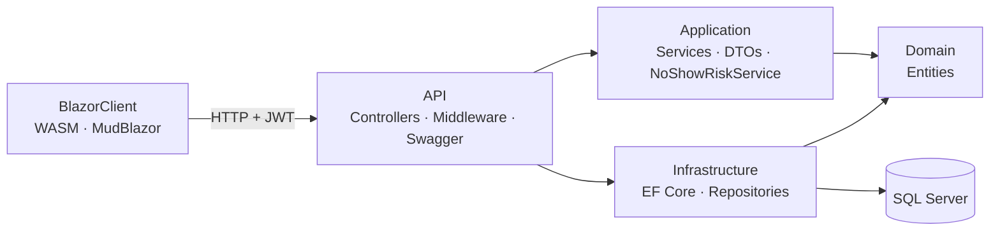

<div align="center">

# 🏥 Hospital No-Show

**An appointment platform that predicts which patients may miss their visit, and adapts the
prediction as SMS reminder replies come in**


[Features](#-features) · [Risk model](#-the-risk-model) · [Architecture](#-architecture) · [Run it](#-run-it) · [Türkçe](#-türkçe)

</div>

---

Missed appointments ("no-shows") waste doctors' time and lengthen waiting lists. This system
manages appointments for **admins, doctors and patients**, and gives every appointment an
**explainable no-show risk score** so clinics can remind, overbook or follow up where it matters.

## ✨ Features

- **Three role-based panels**: an admin dashboard with analytics, a doctor panel with the daily list and risk levels, and a patient panel for booking and cancelling.
- **No-show risk scoring** for every appointment, with a plain-language explanation.
- **SMS-aware recalculation**: confirmations lower the risk and cancellations or no replies raise it.
- **Analytics**: no-show rates by polyclinic, doctor, day and time slot.
- **Secure auth**: ASP.NET Core Identity, JWT bearer tokens and Turkish national-ID validation on registration.
- **Database coursework included**: ER diagram, normalisation, DDL/DML, views, stored procedures, triggers, functions and security (roles, dynamic data masking) in [`database-docs/`](database-docs).
- **UML set**: use-case, class, sequence and eight activity diagrams in [`diagrams/`](diagrams).

## 📊 The risk model

A transparent, weighted model in which each factor is normalised to `0–1`:

| Factor | Weight | | Factor | Weight |
|---|---:|---|---|---:|
| Previous no-shows (Bayesian-smoothed) | **0.35** | | Appointment time | 0.10 |
| Distance to hospital | 0.12 | | Appointment weekday | 0.08 |
| Age group | 0.10 | | Insurance type | 0.08 |
| Slot busyness | 0.10 | | First visit | 0.07 |

`risk = Σ factorᵢ × weightᵢ`, clamped to `[0, 1]` and mapped to a risk level, then adjusted
by the patient's SMS response.

## 🧩 Architecture

Clean Architecture with five projects:



Domain entities include `Patient`, `Doctor`, `Polyclinic`, `Appointment`, `DoctorSchedule`,
`MedicalHistory`, `Medication` and `NoShowAnalytics`.

## 🚀 Run it

Requirements: the .NET 10 SDK and SQL Server LocalDB (or update the connection string in `appsettings.json`).

```bash
# API: applies migrations and seeds demo data on start  → http://localhost:5048/swagger
dotnet run --project src/HospitalNoShow.API

# Client                                                  → http://localhost:5158
dotnet run --project src/HospitalNoShow.BlazorClient
```

> [!IMPORTANT]
> The JWT secret in `appsettings.json` is a development placeholder. Set your own with
> `dotnet user-secrets` or an environment variable (`Jwt__Secret`) before deploying.

## 📁 Project structure

```
src/
├── HospitalNoShow.Domain/          entities and enums
├── HospitalNoShow.Application/     services, DTOs, validation, risk engine
├── HospitalNoShow.Infrastructure/  EF Core DbContext, repositories, migrations
├── HospitalNoShow.API/             controllers, JWT, middleware, seeding
└── HospitalNoShow.BlazorClient/    Admin / Doctor / Patient pages
database-docs/                      ER, normalisation, SQL scripts
diagrams/                           UML diagrams and project plan
```

## 🇹🇷 Türkçe

**Hastane No-Show**, hastaların randevuya gelmeme riskini tahmin eden bir randevu yönetim sistemidir.
Admin, doktor ve hasta panelleri bulunur. Her randevuya geçmiş gelmeme oranı, mesafe, yaş, saat, gün,
sigorta türü, ilk ziyaret ve slot doluluğu gibi ağırlıklı faktörlerden oluşan açıklanabilir bir risk skoru verilir.
Skor, SMS hatırlatmasına verilen yanıta göre güncellenir. .NET 10, Blazor WebAssembly, MudBlazor, EF Core ve
JWT ile Clean Architecture yapısında geliştirilmiştir. Veritabanı dersi belgeleri `database-docs/`, UML diyagramları
`diagrams/` klasöründedir.

---

<div align="center"><sub>Built by <a href="https://github.com/Soap2647">Mert Yasin Yılmaz</a></sub></div>
